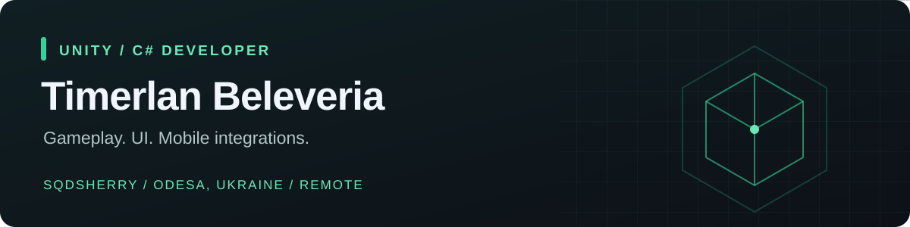

  

  
  
  

## Unity games & interactive applications

I'm **Timerlan Beleveria**, a Unity / C# developer with **1.5+ years of commercial experience** in mobile applications and games. My work includes gameplay mechanics, responsive UI, WebView features and SDK integrations.

**Odesa, Ukraine · Remote only · Full-time or part-time around 20 hours / week**

  <a href="#selected-projects">Explore projects</a> &nbsp; / &nbsp;
  <a href="https://youtu.be/9n1WJOhTLrE">Watch gameplay</a> &nbsp; / &nbsp;
  <a href="mailto:timerlanbelevera@gmail.com">Discuss a role or paid task</a>

## Selected projects

These are personal portfolio prototypes, separate from my commercial work.

### 01 / Auto Service Tycoon

**Unity 6 · C# · URP · Gameplay systems**

A 3D idle / management prototype with vehicle queues, service stations, supplies, staff and progression.

- Separate C# domain models, gameplay services and Unity presentation.
- File-based saves with a temporary-file write and a backup.
- EditMode tests and an in-game debug console for exploring progression.

**[Watch gameplay](https://youtu.be/9n1WJOhTLrE) &nbsp; / &nbsp; [Explore the code](https://github.com/sqdsherry/AutoServiceIdleTycoon)**

---

### 02 / Cooking Simulation

**Unity 6 · C# · Zenject · State machines**

An Overcooked-like prototype with ingredient states, cooking stations and an event-driven order UI. Uses Zenject for dependency injection and factories.

**[Explore the code & gameplay GIF](https://github.com/sqdsherry/PetProjectCook)**

---

### 03 / Wave Spawner

**C# · Object pooling · MVP**

A small subsystem demonstrating configurable enemy waves, object pooling and an MVP-based UI.

**[Explore the code](https://github.com/sqdsherry/WaveSpawner)**

## Tools & practices

| Area | Tools I work with |
| :--- | :--- |
| Engine & language | Unity 3D / 2D, C# |
| Gameplay & structure | Zenject, state machines, ScriptableObjects, Input System |
| UI & async | uGUI, DOTween, UniTask |
| Mobile integrations | Firebase, AppsFlyer, OneSignal, WebView |
| Development | Git, Unity Profiler, AI-assisted coding tools, Unity MCP |

I use AI-assisted tools and Unity MCP for prototyping and Editor workflows.

## Let's work together

Open to **remote Unity roles**, part-time collaboration and **paid tasks** involving gameplay, UI, mobile SDK integration or bug fixes.

**[timerlanbelevera@gmail.com](mailto:timerlanbelevera@gmail.com)** &nbsp; / &nbsp; **[Telegram: @tmrluvbeer](https://t.me/tmrluvbeer)** &nbsp; / &nbsp; **[LinkedIn](https://www.linkedin.com/in/timerlan-beleveria/)**
